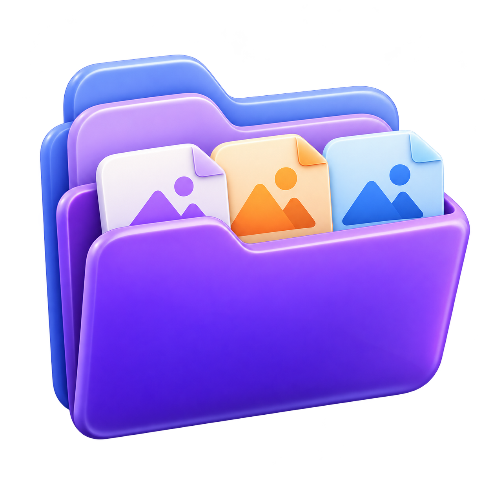
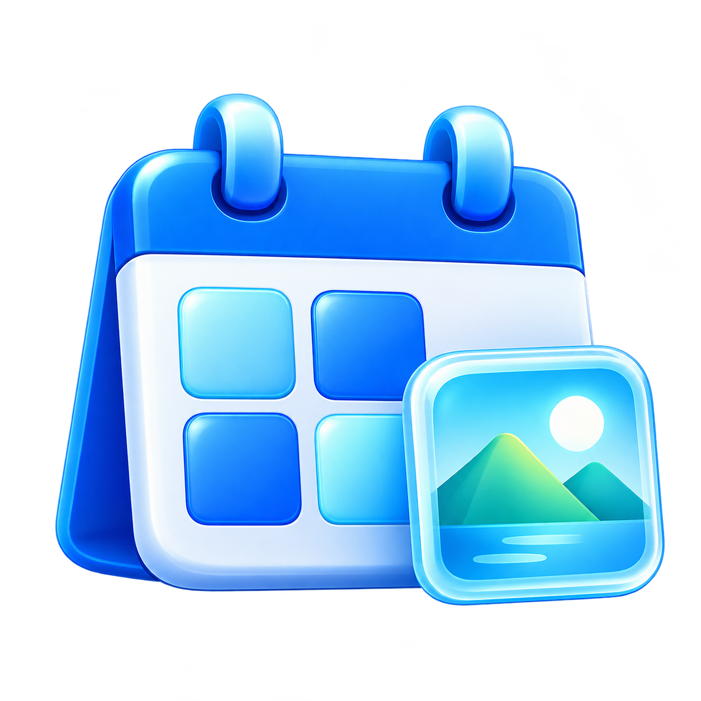
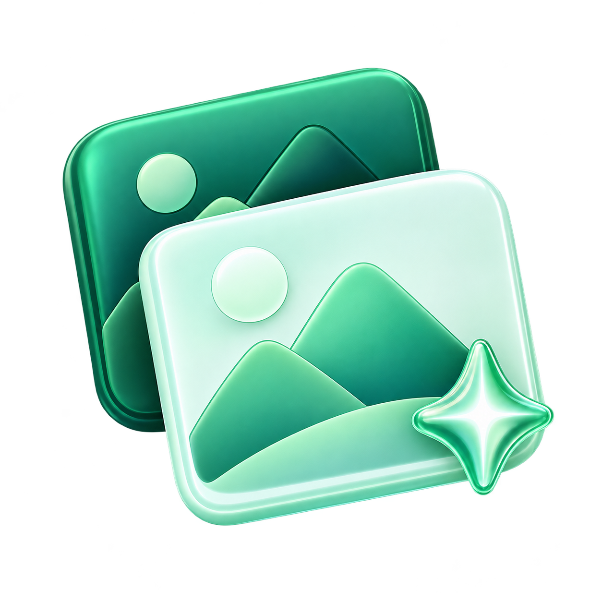
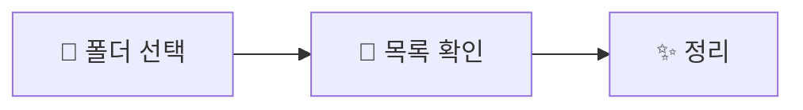

# 📸 사진 정리

**날짜별 · 종류별 · RAW/JPG — 사진 정리를 한곳에서.**

### [⬇️ Windows 설치 파일 다운로드](https://github.com/LOG-JJ/photo-organizer/releases/latest/download/PhotoOrganizer-Setup.exe)

Windows 10 · 11 / 64비트 · 🐍 Python 설치 불필요

| 📅 날짜별 정리 | 🗂️ 파일 분류 | 🔗 RAW · JPG 정리 |
| :---: | :---: | :---: |
|  |  |  |
| 사진·영상 → `YYYY-MM-DD` | `JPG` · `NEF` · `MOV` 폴더로 | 짝 없는 파일 → ♻️ 휴지통 |

🖼️ **보기·정렬 직접 설정**　·　🔄 **업데이트는 앱 종료 후 새 설치 파일 실행**

> 🔎 RAW·JPG는 **파일명**으로 비교합니다. 처음부터 한 형식으로만 촬영한 사진도 목록에 나올 수 있으니 확인하세요.

---

📖 [날짜별 정리](docs/usage/사진_날짜별_정리_사용법.txt) · [파일 분류](docs/usage/파일_분류_사용법.txt) · [RAW/JPG](docs/usage/RAW_JPG_짝없는파일_정리_사용법.txt)

🛠️ [개발 안내](docs/DEVELOPMENT.md)　·　📜 [제3자 라이선스](licenses/THIRD-PARTY-NOTICES.txt)
